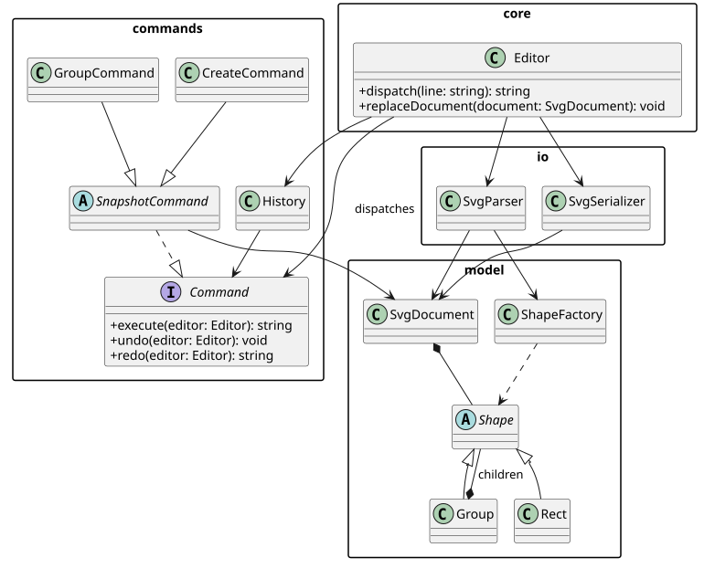

# SVG 编辑器 CLI：Phase 1

github地址：https://github.com/DqChen77/SVG-Editor

## 架构方案

### 模块划分

| 模块 | 目录 | 职责 |
| --- | --- | --- |
| 模型 | `src/model/` | `Shape` 抽象基类、六种 SVG 图形、`Group` Composite、`SvgDocument` 树和唯一 id 索引、`ShapeFactory` 类型创建与读回。 |
| 命令 | `src/commands/` | 每个编辑动作一个 Command 类；`SnapshotCommand` 为原子撤销提供前后快照；`History` 管理 undo/redo 栈。 |
| 核心 | `src/core/` | `Editor` 负责命令名边界、当前文档、IO 生命周期和输出错误；`Tokenizer` 处理引号参数和注释。 |
| IO | `src/io/` | `SvgSerializer` 把模型写成 XML；`SvgParser` 读 SVG、补 id、收集 warning，并在成功后交给核心替换文档。 |
| 入口 | `src/cli.ts` | Node readline REPL，提供 `svg>` 提示符，不承载模型或业务规则。 |
| 测试 | `test/` | 通过 `Editor.dispatch` 覆盖命令、Composite、历史、失败原子性和 SVG round-trip。 |

The editable PlantUML source is [architecture.puml](architecture.puml).
The diagram expands `CreateCommand`, `GroupCommand`, `Group`, and `Rect` as
representatives; the other concrete commands and shapes follow the same
inheritance paths.

### 设计模式的选择

- **Command**：`CreateCommand`、`DeleteCommand`、`MoveCommand`、`ScaleCommand`、`SetCommand`、`GroupCommand`、`UngroupCommand`、`AddToCommand` 和 `ZOrderCommand` 都实现相同的 `Command` 接口。`History` 只依赖接口，因此一条编辑命令对应一个 undo 单元。`SnapshotCommand` 在执行前克隆文档，失败时恢复快照，undo/redo 用快照恢复跨父节点操作的整体状态。
- **Composite**：`Group` 和所有叶子都继承 `Shape`。`move`、`scale`、`delete`、`set` 的调用者不需要区分容器或叶子；容器把几何操作递归传给子树。
- **Factory**：`ShapeFactory` 是唯一的图形类型名到类的分派边界，集中处理 CLI 创建和 SVG 读回。`Editor.command()` 是唯一的命令名分派边界。两处均记录为未来注册表/插件化的待重构点。
- **不采用 Memento 类**：快照的复制与恢复只服务于本阶段的命令历史，直接放在 `SnapshotCommand` 可避免引入只转发数据的额外层；若未来需要持久化历史，再抽出独立 Memento。

### 依赖方向规则

1. `cli -> core`；入口只调用编辑器，不依赖模型或命令实现。
2. `core -> commands, io, model`；核心编排这些能力，但 IO 和模型不反向依赖 CLI。
3. `commands -> model`，并通过类型导入引用 `Editor`；命令不读写文件、不打印 REPL 提示。
4. `io -> model`；序列化和解析只消费/产生模型。
5. `model` 不依赖 `core`、`commands`、`cli`；它保存 SVG 领域不变量。
6. `test` 可以依赖公开入口；生产模块不依赖测试。

这样可以让模型和命令在没有终端或文件系统的情况下测试，也让未来替换 GUI 或 HTTP 入口时不改变领域层。

### 变化点假设

- **命令集合**最可能增加：保留 `Command` 接口和集中注册边界；当前命令名分派是待重构项。
- **图形类型**可能扩展：保留 `ShapeFactory` 边界；`box` 暂不实现，未来可接入 `ShapeProvider` 插件。
- **历史存储**可能从内存变为持久化：当前通过 `Command` 和快照隔离历史，后续可替换 `History`。
- **SVG 语法**可能增加属性或命名空间：解析/序列化已隔离；本阶段只承诺规范列出的几何与样式白名单。
- **入口**可能从 REPL 变为 GUI/HTTP：业务命令集中在 `Editor`，`cli.ts` 只负责 readline。

## 过程记录

1. 初始工作区只有任务说明，没有工程和 Git 仓库；先初始化 npm、TypeScript 和 Git，确保后续提交可追踪。
2. 先建立模型层，再建立命令层；这样 Composite 和 id 索引可以在命令实现前单独编译。
3. `group`、`ungroup`、`addto` 会同时改变多个父节点。实现时选择 `SnapshotCommand`，使它们仍然是一个撤销单元，并用测试确认失败不会留下半成品树。
4. 首次 CLI 回放发现 `create circle` 的可选颜色索引不能复用矩形逻辑，修正为按类型定义必需参数数目；同时将 g 的移动反馈改为增量摘要。
5. 首次 round-trip 测试发现 malformed XML 会被 XML 库写到 stderr，改用 `onError` 收集解析错误，使 CLI 统一返回 `error: cannot read file: ...`。
6. `box` 的完整语义在说明中属于后续插件阶段，因此明确测试其在 Phase 1 返回 `unknown shape type`，没有提前把插件实现混入内核。
7. 原来的 PlantUML fenced code block 在普通 Markdown 预览中不渲染；改为独立 `.puml` 源文件和已生成的 SVG，并在本文件直接嵌入 SVG。

## 一致性自查

### 模块划分

实际目录与方案一致：模型、命令、核心、IO、入口和测试均按上表落地。文档目录额外包含本文件，未把业务逻辑放入文档层。

### 依赖方向

当前生产代码遵守上述方向：`src/model` 没有导入 `core`、`commands` 或 `cli`；文件读写只出现在 `core/Editor.ts` 与 `io` 的边界；命令通过 `Editor` 接口操作当前文档。两处 `switch` 只存在于命令分派和图形工厂，属于说明中允许且已标注的待重构点。

## 质量保证手段

- `npm run build` 使用严格 TypeScript 编译检查。
- `npm test` 编译后运行 Node 内置测试，覆盖：嵌套容器移动/缩放、undo/redo 分支、失败不改状态、group/ungroup/z-order、缺 id 警告、SVG 保存读回、IO 后历史禁用和 `box` 阶段边界。
- 通过 CLI transcript 手工回放流程图创建、保存和撤销，并检查输出 SVG 可以被 XML 解析器读回。
- 关键操作以 `SnapshotCommand` 保证失败原子性；读入文件先解析到临时文档，成功后才替换当前文档。
